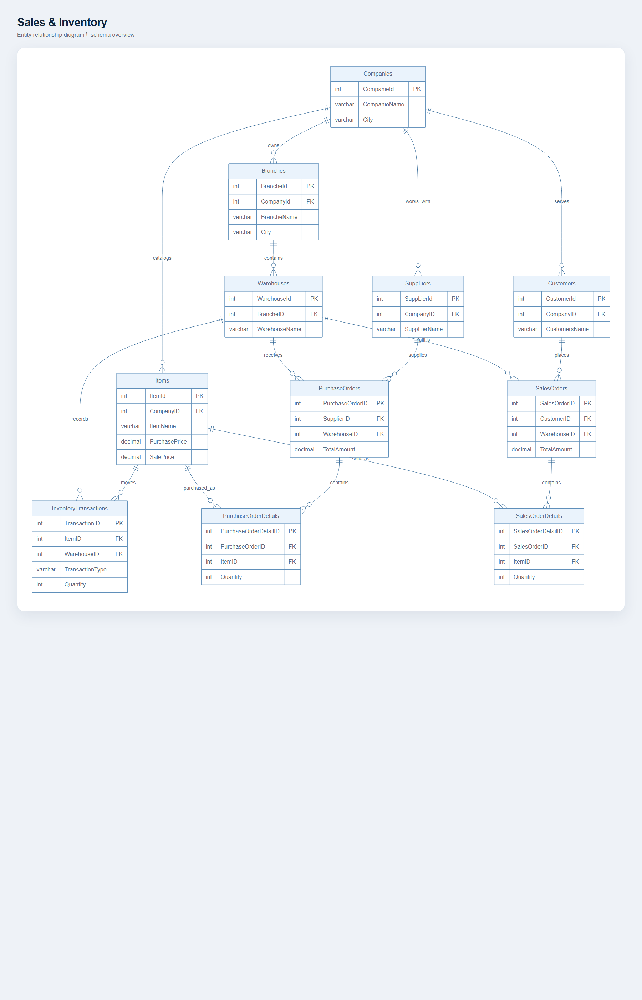

# Sales & Inventory Management Database

A SQL Server database project designed to manage sales, inventory, customers, suppliers, companies, branches, warehouses, and purchase operations.

## Entity relationship diagram

This newly rendered diagram shows all 11 tables, their key columns, and all 15 foreign key relationships from `workDB.sql`. The [editable Mermaid source](docs/ERD.md) is available alongside it.

## Technologies

- Microsoft SQL Server
- SQL Server Management Studio (SSMS)
- T-SQL

## Database Features

- 11 relational tables
- Primary and Foreign Keys
- Constraints and data validation
- Views
- Functions
- Stored Procedures
- Triggers
- Indexes
- Sample data
- Sales and inventory reports

## Main Tables

- Companies
- Branches
- Customers
- Suppliers
- Items
- Warehouses
- PurchaseOrders
- PurchaseOrderDetails
- SalesOrders
- SalesOrderDetails
- InventoryTransactions

## Reports & Analytics

The database includes queries and database objects for:

- Total sales
- Total quantities
- Profit calculation
- Sales grouped by company and city
- Customer sales summary
- Customer debt calculation
- Inventory balance
- Top 10 customers
- Filtered sales reports

## Database Objects

### Views
- SalesAnalyticsView
- SalesByCompanyCity
- TotalItemQuantity
- Profit

### Functions
- FProfit
- Sumarybuy
- TotalPaid

### Stored Procedures
- SalesReport
- InventoryBalance
- Top10Customers
- GetCustomerSales

### Trigger
- CustomerInsertTrigger

## How to Run

1. Open SQL Server Management Studio (SSMS).
2. Open the `workDB.sql` file.
3. Execute the SQL script.
4. The database structure and sample data will be created.

## Purpose

This project demonstrates practical database design and T-SQL skills including relational database modeling, data integrity, reporting, aggregation, functions, stored procedures, triggers, and indexing.

## Verification and screenshots

This repository is a SQL Server script, not a web application, so it has no pages to screenshot. The T-SQL file is [workDB.sql](workDB.sql). A local SQL Server service was present, but this script was not executed against an existing server because it creates `workDB` at a hard-coded SQL Server 2025 data path and sets compatibility level 170; doing so could collide with an existing database or server configuration. Review and adapt the database name, file paths, and compatibility level before running it on a dedicated development server; then inspect the query results in SSMS. No application screenshot is claimed.

