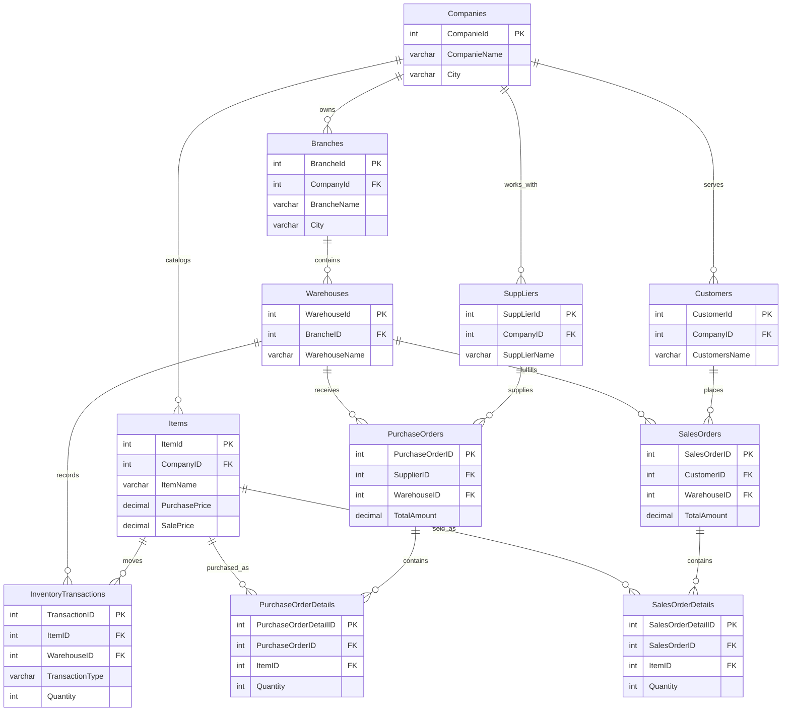

# Entity relationship diagram

This diagram follows the foreign keys in [workDB.sql](../workDB.sql). Crow's foot symbols show how many child rows a parent row can have. The column names preserve the spelling used by the SQL script.

The diagram is a concise schema overview. Optional contact fields, dates, checks, views, stored procedures, and triggers remain documented in the SQL script.
